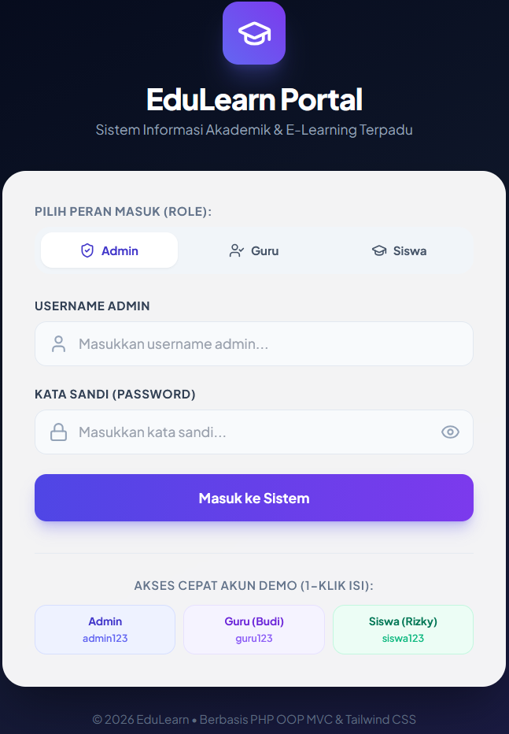
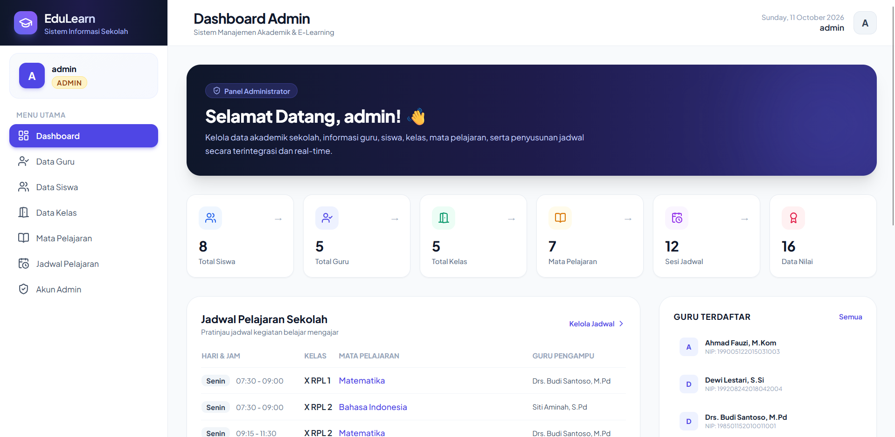
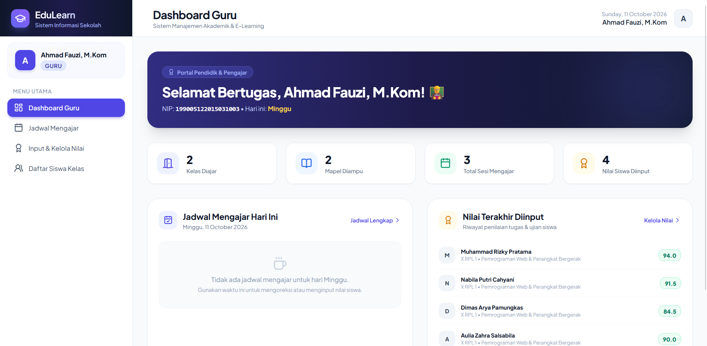

# Sistem Informasi E-Learning & Akademik Sekolah (EduLearn)

Aplikasi E-Learning dan Manajemen Akademik Sekolah berbasis **PHP Native (OOP MVC)**, **MySQL (PDO)**, **Tailwind CSS**, dan **Vanilla JavaScript** yang dibangun sesuai dengan **Product Requirement Document (PRD)** dan Entity Relationship Diagram (ERD).




---

## 🚀 Fitur Utama & Hak Akses (Multi-Role)

### 1. 🛡️ Modul Administrator
* **Dashboard Statistik:** Ringkasan jumlah siswa, guru, kelas, mata pelajaran, jadwal, dan nilai akademik.
* **Manajemen Guru (CRUD):** Tambah, edit (NIP, nama, kata sandi opsional), hapus data guru.
* **Manajemen Siswa (CRUD):** Tambah siswa, tetapkan NIS, nama, password, dan penempatan kelas.
* **Manajemen Kelas (CRUD):** Kelola nama rombel/kelas beserta statistik jumlah siswa dan jadwal aktif.
* **Manajemen Mata Pelajaran (CRUD):** Kelola data mata pelajaran dan pantau guru pengampu.
* **Manajemen Jadwal Pelajaran (CRUD):** Atur jadwal berdasarkan Hari, Jam, Durasi Menit, Kelas, Pelajaran, dan Guru.
* **Manajemen Akun Admin (CRUD):** Kelola kredensial akun administrator.

### 2. 👨‍🏫 Modul Guru
* **Dashboard Pendidik:** Menampilkan jadwal mengajar hari ini secara otomatis sesuai nama hari, profil guru, dan statistik kelas yang diampu.
* **Jadwal Mengajar:** Kalender jadwal mengajar mingguan (Senin s/d Sabtu) yang rapi dan terstruktur.
* **Input & Kelola Nilai Siswa:**
  * Pemilih Kelas dan Mata Pelajaran yang diampu.
  * Form lembar nilai siswa dengan kalkulasi **Predikat (A, B, C, D)** dan status **KKM** secara *real-time*.
  * Opsi simpan per baris maupun **Simpan Batch (Semua Siswa Sekaligus)**.
  * Riwayat nilai yang telah diinput dengan aksi hapus/koreksi.
* **Direktori Siswa:** Daftar siswa per kelas yang diajar.

### 3. 🎓 Modul Siswa
* **Dashboard Siswa:** Profil siswa (NIS, Kelas), ringkasan nilai rata-rata, nilai tertinggi/terendah, dan jadwal kelas hari ini.
* **Jadwal Pelajaran Kelas:** Menampilkan seluruh jadwal kegiatan belajar kelas siswa bersangkutan (Senin - Sabtu).
* **Transkrip Nilai Akademik:**
  * Rapor nilai per mata pelajaran lengkap dengan Guru Pengampu, Angka Nilai, Predikat Huruf, dan Keterangan KKM (Tuntas / Remedial).
  * Tombol **Cetak Rapor** yang telah dioptimasi dengan format ramah cetak (*print-friendly*).

---

## 📂 Struktur Direktori MVC OOP

```text
c:\config\laragon\www\e_learn\
├── app/
│   ├── controllers/         # Controller (AuthController, AdminController, GuruController, SiswaController)
│   ├── core/                # Core Framework (App Router, Base Controller)
│   ├── models/              # Model PDO (Database, Admin, Guru, Siswa, Kelas, Pelajaran, Jadwal, Nilai)
│   └── views/               # Tampilan UI Tailwind CSS
│       ├── admin/           # Dashboard & Views CRUD Admin
│       ├── auth/            # Halaman Login Multi-Role & Quick Demo Fill
│       ├── errors/          # Halaman Error 404
│       ├── guru/            # Dashboard, Jadwal, Nilai, & Siswa Guru
│       ├── layouts/         # Layout Induk (header.php, footer.php, sidebar navigasi responsif)
│       └── siswa/           # Dashboard, Jadwal, & Transkrip Nilai Siswa
├── config/
│   ├── config.php           # Konfigurasi aplikasi, BASE_URL dinamis, CSRF, flash message, auth helpers
│   └── database.php         # Konfigurasi koneksi database PDO
├── public/
│   ├── assets/              # File aset statis
│   │   ├── css/custom.css   # Styling kustom, scrollbar, micro-animations, & format cetak rapor
│   │   └── js/app.js        # Vanilla JS (modal manager, live search, konfirmasi dialog)
│   ├── .htaccess            # URL rewriting untuk clean URL MVC
│   └── index.php            # Entry point aplikasi
├── .htaccess                # URL rewriting root ke folder public
├── database.sql             # Skrip SQL DDL & DML Schema + Seed Data
├── init_db.php              # Skrip migrasi & seeder via CLI PHP
└── prd.md                   # Dokumen PRD acuan
```

---

## 🗄️ Skema Database (MySQL / MariaDB)

Nama Database: `e_learn_db`

1. **`admin`**: `id_admin` (PK), `username`, `password`, `created_at`
2. **`kelas`**: `id_kelas` (PK), `nama`, `created_at`
3. **`guru`**: `id_guru` (PK), `nip` (UNIQUE), `nama`, `password`, `created_at`
4. **`siswa`**: `id_siswa` (PK), `nis` (UNIQUE), `nama`, `password`, `id_kelas` (FK), `created_at`
5. **`pelajaran`**: `pelajaran_id` (PK), `nama_pelajaran`, `created_at`
6. **`jadwal`**: `jadwal_id` (PK), `hari`, `jam`, `menit`, `id_kelas` (FK), `pelajaran_id` (FK), `id_guru` (FK), `created_at`
7. **`nilai`**: `nilai_id` (PK), `nilai`, `id_siswa` (FK), `pelajaran_id` (FK), `id_guru` (FK), `created_at`

---

## 🔑 Kredensial Login Bawaan (Demo)

Halaman login dilengkapi tombol **1-Klik Isi Cepat (Quick Fill)** untuk kemudahan pengujian.

| Peran (Role) | Username / NIP / NIS | Kata Sandi (Password) | Keterangan |
| :--- | :--- | :--- | :--- |
| **Admin** | `admin` | `admin123` | Akses penuh master data & jadwal |
| **Guru** | `198501152010011001` | `guru123` | Drs. Budi Santoso, M.Pd (Guru Matematika) |
| **Guru** | `199005122015031003` | `guru123` | Ahmad Fauzi, M.Kom (Guru Pemrograman Web) |
| **Siswa** | `20241001` | `siswa123` | Muhammad Rizky Pratama (Kelas X RPL 1) |
| **Siswa** | `20241002` | `siswa123` | Nabila Putri Cahyani (Kelas X RPL 1) |

---

## 🌐 Cara Mengakses Aplikasi di Laragon

Aplikasi sudah langsung aktif dan dapat diakses melalui browser Anda:
* **Melalui URL root:** [http://localhost/e_learn/](http://localhost/e_learn/)
* **Melalui URL public:** [http://localhost/e_learn/public/](http://localhost/e_learn/public/)

> **Catatan Database:** Jika sewaktu-waktu ingin mereset basis data ke data awal, jalankan perintah berikut di terminal:
> ```bash
> php init_db.php
> ```
